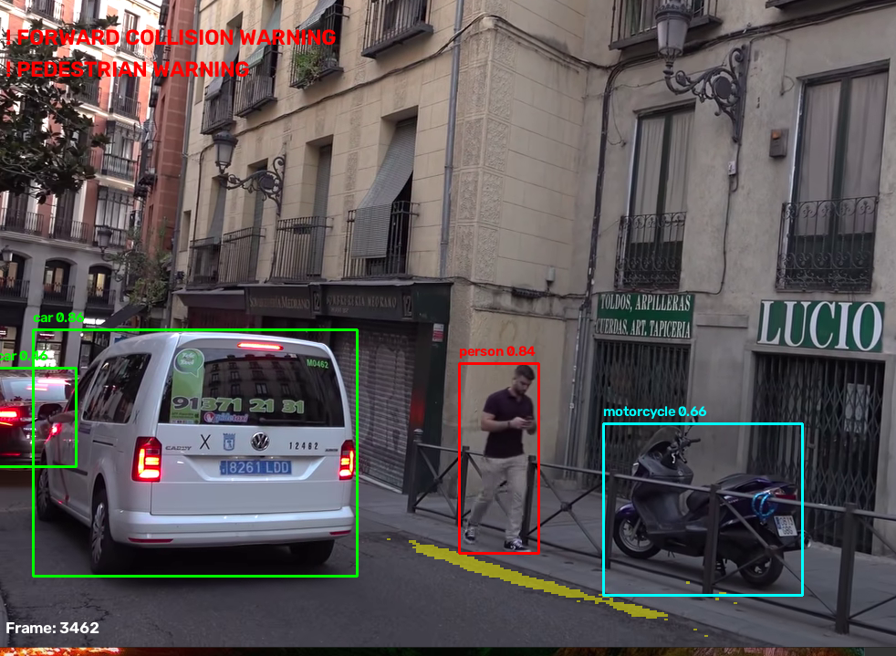
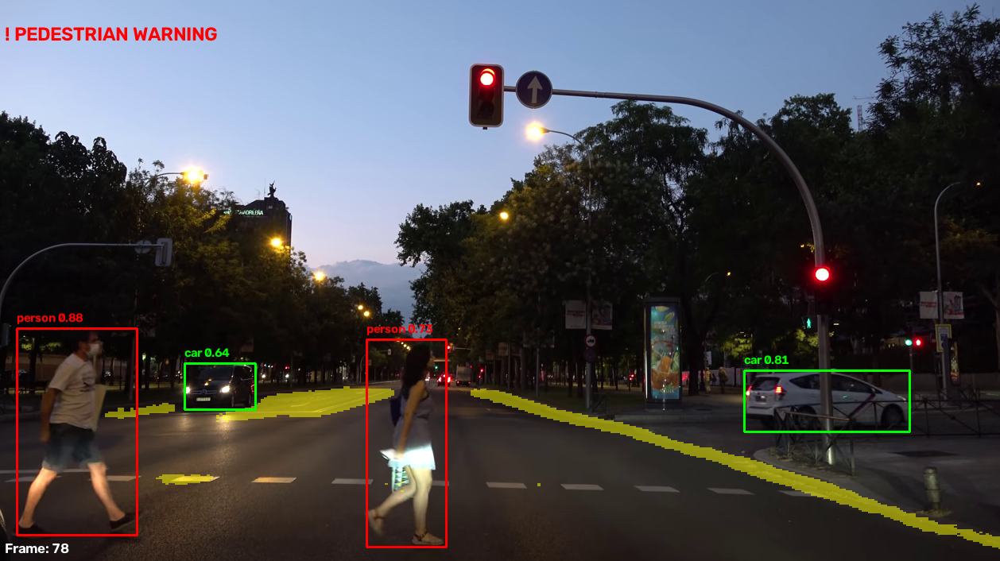
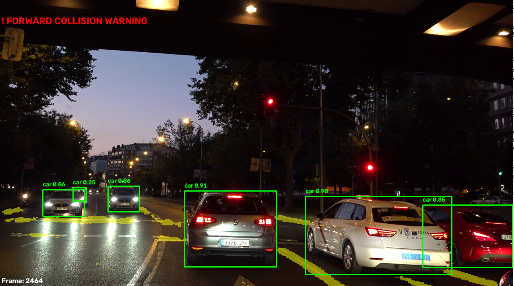

# ADAS Event Simulator

Monocular-camera ADAS simulator: detects vehicles, pedestrians and lane markings with **YOLOv8** + **YOLOP**, and generates **Forward Collision** and **Pedestrian** warnings from dashcam video.



Built as the practical part of my bachelor thesis in Software Engineering (Singidunum University). The system runs on pre-recorded video and a CPU-only machine, so it is a simulator of ADAS warning logic, not a real-time production system.

## Features

- **Object detection** with YOLOv8n (COCO pretrained): cars, trucks, buses, motorcycles, bicycles and pedestrians.
- **Lane-marking segmentation** with YOLOP (BDD100K pretrained, ONNX Runtime), drawn as a yellow overlay.
- **Forward Collision Warning (FCW)** for a vehicle that is close and directly ahead.
- **Pedestrian Warning** for a pedestrian that is close and in front of the vehicle.
- **Event log:** every warning is written to `events_log.csv` with its frame number and timestamp.

| Pedestrian Warning | Forward Collision Warning |
|---|---|
|  |  |

## How it works

A single camera cannot measure distance directly, so the simulator uses the **height of the bounding box relative to the frame height** as a proxy for proximity: the closer an object is, the taller it appears (pinhole camera model).

A warning is raised when both conditions hold:

1. The center of the bounding box is inside the **danger zone**, the central 30–70% of the frame width.
2. The box is tall enough:

| Warning | Object classes | Minimum box height |
|---|---|---|
| FCW | car, truck, bus, motorcycle | > 25% of frame height |
| Pedestrian | person | > 15% of frame height |

All thresholds are constants at the top of `main.py` and can be tuned.

**Rising-edge logging:** an event is logged only when a warning switches from inactive to active, not on every frame while it lasts. One incident therefore produces one log row.

Lane segmentation is visualized but **deliberately not used to trigger warnings**. Lane Departure Warning was implemented first and removed, because monocular lane detection proved too unreliable to trigger warnings from.

## Installation

Requires Python 3.9+.

```bash
git clone https://github.com/0bit027/adas-event-simulator.git
cd adas-event-simulator
pip install -r requirements.txt
```

### Model files

The model files and videos are not stored in this repository (see `.gitignore`).

- **`yolov8n.pt`** is downloaded automatically by Ultralytics on the first run.
- **`yolop-320-320.onnx`** must be downloaded manually from the official [YOLOP repository](https://github.com/hustvl/YOLOP) and placed in the same folder as `main.py`. The input size (320) must match the file name, see `YOLOP_INPUT_SIZE` in `main.py`.

### Video

Use any dashcam clip in `.mp4` format. For example, with [yt-dlp](https://github.com/yt-dlp/yt-dlp) you can download a section of a video (make sure you are allowed to use the footage):

```bash
yt-dlp --download-sections "*1:30-3:30" -f "bv*[height<=720]+ba/b[height<=720]" --merge-output-format mp4 -o "video.mp4" "<VIDEO_URL>"
```

## Usage

```bash
python main.py video.mp4
```

A window shows the video with detections, the lane overlay and active warnings. Press **`q`** to stop early. When the video ends (or you quit), a summary is printed:

```
--- Sazetak ---
Forward Collision Warning: N put(a)
Pedestrian Warning: N put(a)
Detalji upisani u events_log.csv
```

### Output: `events_log.csv`

| Column | Meaning |
|---|---|
| `frame` | Frame number where the warning started |
| `vreme_sekunde` | Time in the video, in seconds |
| `dogadjaj` | Event type: `FCW` or `PEDESTRIAN` |

The log is overwritten on every run. Column names and console messages are in Serbian, as is the thesis.

## Results

Two 2-minute dashcam clips from Madrid, processed on a CPU-only PC (about 12 fps, roughly 2.5x slower than real time):

| Clip | Scene | FCW | Pedestrian |
|---|---|---|---|
| 1 | Highway, 3 lanes | 3 | 14 |
| 2 | Narrow one-way streets in the city center | 13 | 56 |

Warnings in dense city traffic are much more frequent, which is expected: more pedestrians, parked and moving vehicles, motorcycles and bicycles close to the camera.

## Limitations

- **Distance is approximate.** Box height depends on the object type: a truck or bus appears larger than a car or motorcycle at the same distance, so one threshold cannot be exact for all vehicles.
- **No object tracking.** A pedestrian who disappears behind a vehicle and reappears is counted as a new event, which inflates the counts at crossings.
- **The danger zone is fixed.** It does not follow the lane or the vehicle's trajectory, so it ignores turning and can trigger on objects beside the road in narrow streets.
- **Not real-time on CPU.** About 12 fps on the test machine; a GPU would be needed for real-time use.
- **No Lane Departure Warning**, for the reason described above.

## Built with

- [Ultralytics YOLOv8](https://github.com/ultralytics/ultralytics), object detection (AGPL-3.0)
- [YOLOP](https://github.com/hustvl/YOLOP), panoptic driving perception (MIT)
- [COCO](https://cocodataset.org/) and [BDD100K](https://bdd-data.berkeley.edu/) datasets the models were trained on
- OpenCV, NumPy, ONNX Runtime

## License

The code in this repository is released under the **MIT** license, see [LICENSE](LICENSE). Third-party components keep their own licenses: Ultralytics YOLOv8 is AGPL-3.0 and YOLOP is MIT, so check the Ultralytics terms before using this project in anything beyond study or research.
